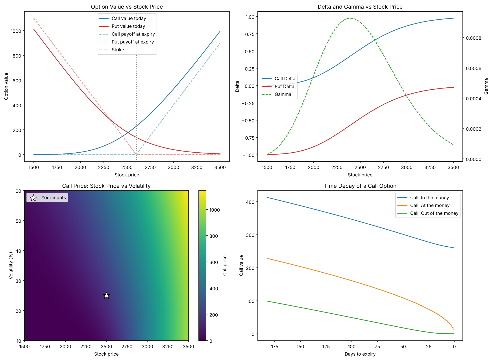
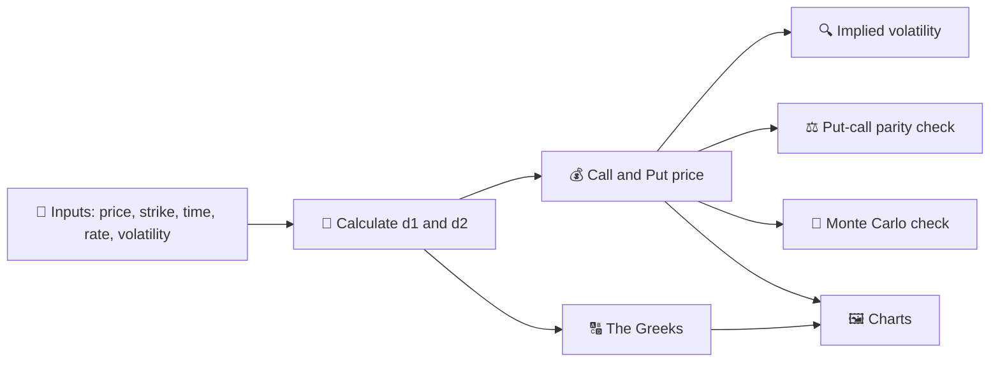

<!-- ===================== HEADER ===================== -->
<div align="center">


<a href="https://github.com/PrabhatDev28/black-scholes-options-pricing">
  
</a>

<br/>


<br/>

<a href="https://colab.research.google.com/github/PrabhatDev28/black-scholes-options-pricing/blob/main/Black_Scholes_Options_Pricing.ipynb">
  
</a>

</div>

---

## 📑 Contents
[Features](#-features) · [Demo](#-demo) · [How it works](#-how-it-works) · [Formulas](#-the-math-in-simple-words) · [Greeks](#-the-greeks-explained) · [Run it](#-run-it-in-2-minutes) · [Sample output](#-sample-output) · [Ideas](#-ideas-to-try-next)

---

## ✨ Features

| | Feature | What it does |
|---|---|---|
| 💰 | **Option pricing** | Calculates the fair price of European call and put options |
| 🔠 | **The Greeks** | Delta, Gamma, Vega, Theta and Rho: how the price reacts to changes |
| 🔍 | **Implied volatility** | Works backwards from a market price to find the volatility the market expects |
| ⚖️ | **Put-call parity check** | Confirms the call and put prices are consistent with each other |
| 🎲 | **Monte Carlo check** | Simulates 200,000 future prices to double-check the formula |
| 📈 | **4 charts** | Value vs price, Delta and Gamma, a volatility heatmap, and time decay |
| 🧩 | **Dividend support** | Optional dividend yield input |

**Tech:** Python · NumPy · pandas · SciPy · Matplotlib

---

## 📈 Demo

<div align="center">



*Example: a 6-month option on a stock at 2,500 with a strike of 2,600, 25% volatility and a 7% interest rate.*

</div>

| Chart | What to notice |
|---|---|
| **Option value vs stock price** | The solid line is the option's value today. The dashed line is what it pays at expiry. The gap between them is the "time value" |
| **Delta and Gamma** | Delta shows how much the option moves when the stock moves ₹1. Gamma shows how fast Delta itself changes |
| **Volatility heatmap** | Brighter colors mean a more expensive call. Higher volatility makes options cost more |
| **Time decay** | Options lose value as expiry gets closer, and the loss speeds up at the end |

---

## 🧠 How it works



1. Enter the **5 inputs**: stock price, strike price, time to expiry, interest rate and volatility.
2. The model calculates **d1** and **d2**, two numbers that describe how likely the option is to finish in the money.
3. It uses them to get the **call and put prices**.
4. It calculates the **Greeks** to show how risky the option is.
5. It finds the **implied volatility** from a market price using a root-finding method (`brentq`).
6. It **double-checks** the answer with put-call parity and a Monte Carlo simulation.

<details>
<summary><b>🤔 What is an option?</b></summary>

<br/>

An option is a contract that gives you the **right, but not the obligation**, to trade a stock at a fixed price (the **strike**) on or before a fixed date.

- A **call** option lets you **buy** at the strike. It gains value when the stock goes up.
- A **put** option lets you **sell** at the strike. It gains value when the stock goes down.

The big question is: what is that right worth today? Black-Scholes answers it.

</details>

<details>
<summary><b>🤔 What is implied volatility?</b></summary>

<br/>

Volatility is how much a stock's price jumps around. It is the only input of the model you cannot see directly. **Implied volatility** flips the problem: take the real price traders are paying for the option, and find the volatility that makes the formula match it. It tells you how much movement the market is expecting.

</details>

### ⚙️ Settings you can change

| Setting | Default | What it controls |
|---|---|---|
| `S` | `2500` | Current stock price |
| `K` | `2600` | Strike price |
| `T` | `0.5` | Time to expiry in years (0.5 = 6 months) |
| `r` | `0.07` | Risk-free interest rate per year |
| `sigma` | `0.25` | Volatility per year |
| `q` | `0.0` | Dividend yield per year |
| `MARKET_CALL_PRICE` | `150` | A market price used to find implied volatility |

---

## 🧮 The math in simple words

$$d_1 = \frac{\ln(S/K) + (r - q + \sigma^2/2)\,T}{\sigma\sqrt{T}} \qquad d_2 = d_1 - \sigma\sqrt{T}$$

| Option | Formula |
|---|---|
| **Call** | $C = S e^{-qT} N(d_1) - K e^{-rT} N(d_2)$ |
| **Put** | $P = K e^{-rT} N(-d_2) - S e^{-qT} N(-d_1)$ |

| Symbol | Meaning |
|---|---|
| $S$ | Current stock price |
| $K$ | Strike price |
| $T$ | Time to expiry (years) |
| $r$ | Risk-free interest rate |
| $\sigma$ | Volatility |
| $N(\cdot)$ | Chance from the standard normal curve (a number between 0 and 1) |

---

## 🔠 The Greeks explained

| Greek | Question it answers | Example reading |
|---|---|---|
| **Delta** | If the stock rises by ₹1, how much does the option price change? | Delta of 0.53 means the option gains about ₹0.53 |
| **Gamma** | How fast does Delta change as the stock moves? | High Gamma means Delta can change quickly |
| **Vega** | If volatility rises by 1%, how much does the option price change? | Vega of 7.04 means the price rises by about ₹7.04 |
| **Theta** | How much value does the option lose each day just from time passing? | Theta of -0.70 means it loses about ₹0.70 per day |
| **Rho** | If interest rates rise by 1%, how much does the option price change? | Rho of 5.72 means the price rises by about ₹5.72 |

---

## 🚀 Run it in 2 minutes

**Option 1: Google Colab (no installation)**

1. Click the **Open in Colab** button above.
2. Choose **Runtime → Run all**.
3. Edit the **Settings** cell to try your own numbers, then run all again.

**Option 2: Your own computer**

```bash
git clone https://github.com/PrabhatDev28/black-scholes-options-pricing.git
cd black-scholes-options-pricing
pip install -r requirements.txt
python black_scholes_model.py
```

> 💡 This project needs no internet or data download. It runs entirely from the numbers you type in.

---

## 🧾 Sample output

Using the default settings:

| | Call | Put |
|---|---|---|
| **Price** | 171.22 | 181.79 |
| **Delta** | 0.5257 | -0.4743 |
| **Gamma** | 0.0009 | 0.0009 |
| **Vega** | 7.0377 | 7.0377 |
| **Theta (per day)** | -0.7013 | -0.2198 |
| **Rho** | 5.7154 | -6.8375 |

- **Implied volatility:** a market call price of 150 means the market expects about **22.0%** volatility.
- **Put-call parity:** `C - P = -10.5741` on both sides, so the prices are consistent.
- **Monte Carlo:** the simulation gives 171.41 for the call, which matches the formula's 171.22 within the margin of error.

---

## 📂 Project structure

```
├── Black_Scholes_Options_Pricing.ipynb   # Google Colab version
├── black_scholes_model.py                # Python script version
├── requirements.txt
├── bs_results.png
├── LICENSE
└── README.md
```

---

## 💡 Ideas to try next

- [ ] Download a real stock price with `yfinance` and use its past volatility as `sigma`
- [ ] Plot an implied volatility "smile" using real option prices
- [ ] Add a binomial tree model and compare it with Black-Scholes
- [ ] Price American options, which can be exercised early
- [ ] Build a small Streamlit app with sliders for each input

---

## 📝 Notes

- Black-Scholes prices **European** options, which can only be exercised at expiry.
- It assumes **constant volatility** and constant interest rates, which real markets don't have.
- Real option prices on exchanges also depend on demand, supply and trading costs.
- This is a learning project and **not financial advice**.

---

<div align="center">

**Built by [Prabhat Mishra](https://github.com/PrabhatDev28)** · If this helped you, a ⭐ means a lot!


</div>
